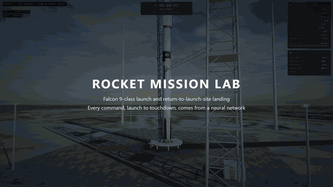
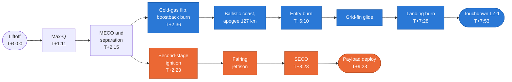
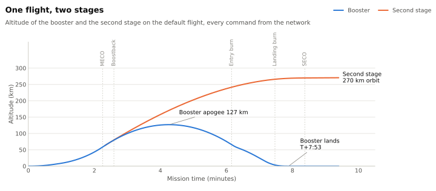
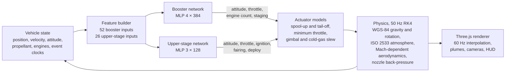
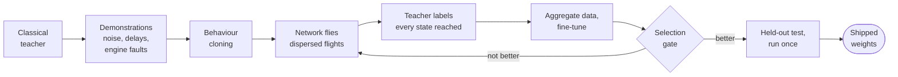
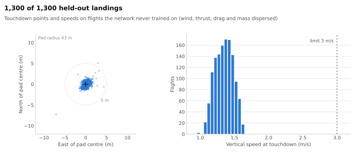
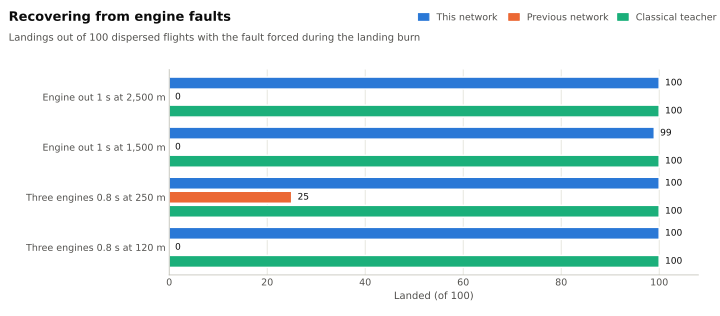

<div align="center">


# Rocket Mission Lab

**A Falcon 9-class launch and return-to-launch-site landing, flown end to end by a neural network.**

[](https://github.com/ishtiaq-ahmed-dev/rocket-mission-lab/actions/workflows/ci.yml)
[](LICENSE)




**[▶ Watch the full 90-second video](https://github.com/ishtiaq-ahmed-dev/rocket-mission-lab/releases/download/v1.0.0/rocket-mission-lab-launch-and-landing.mp4)** &nbsp;·&nbsp; [How it was trained](docs/FLIGHT-POLICY.md) &nbsp;·&nbsp; [Standards and limits](docs/STANDARDS.md)

</div>

---

Two neural networks fly the whole mission at 10 Hz from the vehicle's own state: the booster from liftoff to touchdown on Landing Zone 1, and the second stage to orbit. Every command that changes the flight comes from them: engine ignition, cutoff and engine count, throttle, attitude, stage separation, second-stage burn, fairing jettison and payload deploy. The page contains the physics and the network weights, with **no scripted guidance and no fallback controller**; if the weights fail to load, the page stops instead of flying something else.

<table>
<tr>
<td align="center"><h3>1,300 / 1,300</h3>held-out missions completed,<br>on flights it never trained on</td>
<td align="center"><h3>10,056 / 10,056</h3>dispersed evaluation missions<br>(wind, thrust, drag, mass)</td>
<td align="center"><h3>399 / 400</h3>landings after a forced<br>engine fault (previous network: 25)</td>
<td align="center"><h3>1.44 m/s · 1.4 m</h3>default touchdown speed<br>and distance from pad centre</td>
</tr>
</table>

## Contents

- [The mission](#the-mission)
- [Flow of control](#flow-of-control)
- [The networks](#the-networks)
- [How it learned](#how-it-learned)
- [Results](#results)
- [Quick start](#quick-start)
- [Train and validate](#train-and-validate)
- [Project structure](#project-structure)
- [Scope and limits](#scope-and-limits)

## The mission

The profile follows public Falcon 9 return-to-launch-site practice, from SLC-40 to LZ-1 at Cape Canaveral, over public-domain USGS imagery.



<picture>
  <source media="(prefers-color-scheme: dark)" srcset="docs/assets/mission-profile-dark.svg">
  
</picture>

| Phase | What happens | This replay | Falcon 9 RTLS |
| --- | --- | --- | --- |
| Ascent | Hold-down until thrust exceeds weight, pitch kick, gravity turn, throttle bucket through max-Q | Max-Q T+1:11, 25.5 kPa | T+1:12 |
| MECO and separation | Nine engines cut and tail off; pneumatic pushers separate the stages | T+2:15, 58.8 km, 1.81 km/s | T+2:17–2:33, ~60–65 km |
| Flip and boostback | Nitrogen thrusters turn the booster once the upper stage is clear; three engines burn back toward the launch site, never toward the ground | T+2:36–3:30 | T+2:42–3:28 |
| Coast | Engines off, engines leading; the booster keeps climbing on its own momentum | Apogee 127 km | ~130 km |
| Entry burn | Three engines against the airflow near 66 km | T+6:10–6:21 | T+6:18–6:30 |
| Landing burn | One engine lit at the last feasible moment; two steady leans carry it over the pad, then it comes down upright. If the engine goes out it relights; if it stops above the pad it cuts, falls and relights | T+7:28 from 3.6 km | T+7:22–7:33 |
| Orbit | Closed-loop insertion, payload deploy 60 s after SECO | 269 × 342 km, SECO T+8:23 | SECO T+8:48 |

## Flow of control

The simulator, the networks and the renderer all run in one page. Physics integrates at 50 Hz (RK4); the networks are evaluated at 10 Hz and their commands are held between evaluations.



Mission phases on the HUD are *read out* of the vehicle's state (staged? which burn? engines on?); they never select behaviour. The simulator may limit what a command can do, through actuator physics, but never rewrites one, and `scripts/check_flight.js` verifies that on every build.

## The networks

| | Booster network | Upper-stage network |
| --- | --- | --- |
| Flies | The stack during ascent, then the returning booster | The second stage after separation |
| Inputs | 52: position and velocity relative to LZ-1 at three scales, direction of motion, attitude, propellant, engine state, dynamic pressure, Mach, event clocks, and two kinematic predictions (vacuum impact point, undiverted touchdown point) | 26: altitude, inertial velocity, attitude, propellant, engine and staging state, orbital energy against the 300 km target, event clocks |
| Architecture | MLP, 4 hidden layers × 384, SiLU | MLP, 3 hidden layers × 128, SiLU |
| Outputs | Thrust direction, throttle, engine count (0, 1, 3 or 9), staging command | Attitude, throttle, engine on/off, fairing jettison, payload deploy |

Weights ship as base64 float32 in [`frontend/public/flight-policy.js`](frontend/public/flight-policy.js) (2.7 MB) and are evaluated by a small runtime inside the page.

## How it learned

The networks imitate a classical **teacher** that is never shipped: a predictive controller that simulates the rest of the return from any state, so it can label whatever state the network reaches. Training uses DAgger, so the network learns from its own mistakes rather than only from perfect demonstrations.



The gate flies 2,000 selection flights and the fault-recovery tests; a candidate that crashes more often than the incumbent is rejected even if it completes more missions. Behaviour cloning and every fine-tune run on the GPU with the training set held in GPU memory.

The last round of work came from reading the network's engine logs on its rare crashes (about 1 in 1,000 flights). They were the teacher's fault: after an early engine cutoff it said "stay off", and when the booster rose above the pad it said "keep thrusting". Fixing those labels, removing 278,423 mislabelled training rows and adding engine faults to the training flights removed the crashes. The full story, including the dispersion model and every evaluation set, is in [docs/FLIGHT-POLICY.md](docs/FLIGHT-POLICY.md).

## Results

Every flight below is dispersed: wind 0–100 % in any direction, Merlin and MVac thrust ±1 %, drag ±5 %, booster dry mass ±300 kg, payload ±1,000 kg. A full mission means orbit, fairing release, payload deploy, and a touchdown on deployed legs slower than 3 m/s vertically and 1.5 m/s sideways, tilted under 5° and inside the 43 m pad radius.

<picture>
  <source media="(prefers-color-scheme: dark)" srcset="docs/assets/touchdown-dark.svg">
  
</picture>

| Dispersed flights | Neural network | Classical teacher |
| --- | --- | --- |
| **Held-out, seeds 900000–900299** | **300 / 300** | 300 / 300 |
| **New held-out, seeds 910000–910999** | **1,000 / 1,000** | 1,000 / 1,000 |
| Validation, seeds 600000–600499 | 500 / 500 | 500 / 500 |
| Development gate, seeds 800000–800255 | 256 / 256 | |
| Selection, seeds 300000–301999 | 2,000 / 2,000 | 2,000 / 2,000 |
| Fresh, seeds 472000–477999 | 6,000 / 6,000 | |

On the same 6,000 fresh flights the previous network completed 5,987, with four crashes. To test recovery, faults were forced during the landing burn on 100 more flights each:

<picture>
  <source media="(prefers-color-scheme: dark)" srcset="docs/assets/fault-recovery-dark.svg">
  
</picture>

Evidence lives in [`data/flight-policy-validation.json`](data/flight-policy-validation.json) (written by `scripts/flight_policy/evaluate.js`, tied to the hashes of the shipped simulator and weights) and [`data/standards-validation.json`](data/standards-validation.json).

## Quick start

Requires Node.js 22 or later.

```bash
cd frontend
npm ci
npm run dev
```

Open <http://127.0.0.1:5180/>. `npm run build` writes a static production bundle to `frontend/dist`.

| Key | Action |
| --- | --- |
| `1` – `7` | Cameras: orbit, chase, launch tower, booster top cam, landing pad, overview, orbital view |
| `F` | Switch focus between the stack and the booster |
| `Space` · `←` `→` | Play/pause · seek |
| `H` · `M` | Hide the HUD · model notes (assumptions and this run's figures) |

The timeline marks every event, and playback runs from 0.1× to 30×.

## Train and validate

Training runs the flights in Node (the simulator is the page's own JavaScript) and fits the networks with PyTorch. Datasets, candidates and checkpoints stay in the ignored `data/flight-policy/` folder.

```bash
python -m venv .venv
.venv/Scripts/python -m pip install -r requirements.txt          # Windows; use .venv/bin/python elsewhere

node scripts/flight_policy/dagger.js --demos 240 --iters 10 --per-iter 200           # demonstrations, cloning, DAgger
node scripts/flight_policy/mine.js hardA 460000 6000 --fails-only                     # hard-example mining
node scripts/flight_policy/evaluate.js                                               # held-out evaluation record
```

`dagger.js --fresh` starts over and deletes the existing datasets. A new candidate replaces the shipped weights only after a matched comparison on the nominal flight and 256 development seeds; candidates with more crashes or lost missions are rejected.

```bash
python scripts/check.py                  # everything below, as CI runs it
node scripts/check_flight.js             # every frame of the shipped flight: event order, limits, no scripted guidance
node scripts/check_standards.js          # WGS-84, ISO 2533 / US 1976, Merlin/MVac and mass-closure anchors
node --test scripts/check_regressions.js # simulator, playback and teacher regressions
python -m pytest tests -q                # training pipeline
python scripts/readme_figures.py         # regenerate the figures in this README
```

## Project structure

```text
rocket-mission-lab/
├── frontend/
│   ├── index.html              # simulator, network runtime, renderer and HUD in one page
│   └── public/
│       ├── flight-policy.js    # trained weights for both networks
│       ├── three.min.js        # vendored Three.js r180
│       └── assets/             # USGS imagery of Cape Canaveral, CC0 terrain textures
├── scripts/
│   ├── flight_policy/          # teacher, rollouts, DAgger, mining, gate, evaluation, train.py
│   ├── check_flight.js         # flight invariants for the shipped page
│   ├── check_standards.js      # public-standard anchors and default-flight regression
│   ├── check_regressions.js    # regression tests
│   ├── fetch_imagery.py        # builds the ground imagery from USGS orthoimagery
│   └── readme_figures.py       # figures in this README
├── data/                       # validation records and the reference profile
├── docs/                       # flight policy, standards, history, figures and logo
└── tests/                      # training-pipeline tests
```

## Scope and limits

This is a simulation study, not flight software or a certification claim.

- Point-mass translational dynamics with a rate-limited first-order attitude response; no rigid-body rotation, slosh, structural or thermal loads.
- Public Falcon 9 figures anchor the vehicle; dry masses and aerodynamic coefficients are modelled.
- The network imitates an educational teacher; its reliability is a measured rate on simulated dispersions.
- Plume shape follows nozzle exit pressure against the ambient atmosphere; turbulence, smoke, legs and fins are illustrative.

More in [docs/STANDARDS.md](docs/STANDARDS.md) and the in-page **MODEL NOTES** panel. The project's evolution, from early reinforcement-learning experiments to this network, is in [docs/HISTORY.md](docs/HISTORY.md).

## Credits

- Ground imagery: USGS The National Map orthoimagery (NAIP, Landsat, Blue Marble), public domain. Terrain textures: Poly Haven, CC0. See [frontend/public/assets/ATTRIBUTION.md](frontend/public/assets/ATTRIBUTION.md).
- Rendering: [Three.js](https://threejs.org/) (MIT).
- Mission timeline references: public SpaceX webcasts and the Falcon user's guide.

## License

Released under the [MIT License](LICENSE).

<div align="center">
<sub>Built by <a href="https://github.com/ishtiaq-ahmed-dev">Ishtiaq Ahmed</a></sub>
</div>
